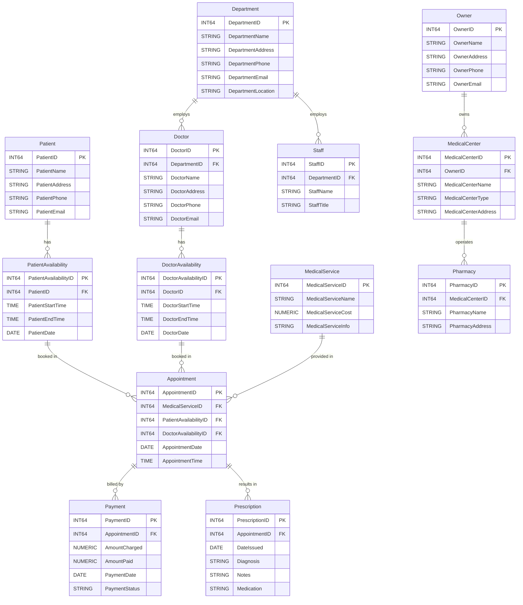

# Healthcare Appointment Scheduling Database

**A relational database and SQL analytics project, built on Google Cloud BigQuery, that models how hospitals and clinics schedule appointments, bill patients, issue prescriptions, and track operating performance.**


-success)


> Built as a team project ("Group 4: Healthcare Analytics") for **MGMT 544**. The work covers the full path from business requirements to a normalized schema, sample data, analytical SQL, and a presentation to stakeholders.

<!--
  TIP: Add 2–4 bullets here about the parts YOU personally owned, for example:
  ## My Contributions
  - Designed the ... tables and their keys
  - Wrote and tested queries #X, #Y, #Z
  - Built and presented the ... slides
  Recruiters look for this section on team projects.
-->

---

## Table of Contents

1. [Project Highlights](#project-highlights)
2. [Skills Demonstrated](#skills-demonstrated)
3. [The Business Problem](#the-business-problem)
4. [Database Design](#database-design)
5. [Business Questions Answered with SQL](#business-questions-answered-with-sql)
6. [Featured Queries and Results](#featured-queries-and-results)
7. [How to Run It](#how-to-run-it)
8. [Repository Structure](#repository-structure)
9. [Limitations and Next Steps](#limitations-and-next-steps)

---

## Project Highlights

| | |
|---|---|
| **13 related tables** | Patients, doctors, departments, staff, services, availability, appointments, payments, prescriptions, medical centers, owners, and pharmacies |
| **11 foreign-key relationships** | Model how patients, providers, billing, and pharmacies connect in a real healthcare operation |
| **Normalized to Third Normal Form (3NF)** | Atomic values, single-column primary keys, no transitive dependencies |
| **11 analytical queries** | Answer 10 business questions about demand, revenue, billing health, scheduling conflicts, and prescribing |
| **Cloud data warehouse** | Implemented and run in Google Cloud BigQuery |
| **Stakeholder presentation** | Findings presented to a non-technical audience (see the PDF deck) |

---

## Skills Demonstrated

| Area | What this project shows |
|---|---|
| **Relational data modeling** | Turning a business scenario into entities, attributes, and relationships; choosing primary and foreign keys |
| **Normalization** | Applying 1NF, 2NF, and 3NF to remove redundancy and update anomalies |
| **SQL DDL** | `CREATE OR REPLACE TABLE`, data types (`INT64`, `STRING`, `NUMERIC`, `DATE`, `TIME`), `NOT NULL`, `PRIMARY KEY`, `FOREIGN KEY` |
| **SQL DML** | Seeding every table with consistent sample data using multi-row `INSERT` statements |
| **Analytical SQL** | Multi-table `JOIN`s (up to five tables), `LEFT JOIN`, `GROUP BY`, aggregates (`COUNT`, `SUM`, `AVG`), scalar subqueries, `ROUND`, `BETWEEN`, `NOT BETWEEN`, date functions (`DATE_DIFF`, `CURRENT_DATE`), sorting for ranking |
| **Data quality checks** | A query that finds appointments booked outside a doctor's available hours |
| **Cloud tools** | Google Cloud Platform, BigQuery datasets, saved queries, and shared query links |
| **Business analysis** | Framing questions that matter to executives, finance, and operations, then explaining what each result means |
| **Communication and teamwork** | Delivering the project as a team and presenting results in plain language |

---

## The Business Problem

Hospitals, clinics, and medical centers often manage scheduling, billing, and patient follow-up in separate systems. That leads to double-booked doctors, patients who don't know what a treatment costs, unpaid bills that go unnoticed, and executives who lack a clear view of performance.

This database brings that information into one place. It:

- **Prevents scheduling conflicts** by tying every appointment to a doctor's and a patient's availability window.
- **Makes costs clear before booking** by storing each medical service with its price and description.
- **Improves communication** among patients, doctors, staff, and administrators through shared contact and department data.
- **Supports financial oversight** by recording the amount charged, the amount paid, and the payment status for each appointment.
- **Supports follow-up care** by storing diagnoses, notes, and medications for each visit.
- **Gives leaders data for decisions** on staffing, pricing, and resource allocation.

---

## Database Design

### Entity-Relationship Diagram



*(Some contact columns, such as phone and email, are left out of a few entities above to keep the diagram readable. The full definitions are in [`HealthcareDB.sql`](HealthcareDB.sql).)*

### Key Design Decisions

- **Availability is its own entity.** An appointment does not point straight to a doctor and a patient. It points to a `DoctorAvailability` slot and a `PatientAvailability` slot. This models the real scheduling workflow, where a booking is the match between two open time windows, and it makes conflict checks possible with a simple join.
- **Billing is separate from scheduling.** `Payment` stores both `AmountCharged` and `AmountPaid`, so the database can show full, partial, and pending payments and support revenue and collections reporting.
- **Clinical follow-up is linked to the visit.** `Prescription` references `Appointment`, so every diagnosis and medication can be traced back to the visit, the doctor, and the department.
- **Business ownership is modeled separately.** `Owner → MedicalCenter → Pharmacy` captures the business side of the network, apart from the clinical side.
- **Money uses `NUMERIC`.** Costs and payments use BigQuery's exact decimal type to avoid floating-point rounding errors.

### Normalization

| Normal Form | How the schema meets it |
|---|---|
| **1NF** | Every column holds one atomic value (names, addresses, phones, emails, dates, times, and amounts are separate columns). Multiple availabilities or appointments are stored as separate rows, not repeated columns. |
| **2NF** | Every table has a single-column primary key, so no attribute can depend on only part of a key. |
| **3NF** | Non-key attributes depend only on their own table's key. For example, department details live in `Department`, not repeated on every `Doctor` row, and service prices live in `MedicalService`, not on every `Appointment`. |

### Sample Data

The script seeds all 13 tables with 5 consistent rows each (65 records in total). The data covers 5 patients, 5 doctors across Cardiology, Pediatrics, Radiology, Neurology, and Orthopedics, 5 services from vaccinations ($30) to MRI scans ($500), and appointments, payments, and prescriptions for November 2025.

---

## Business Questions Answered with SQL

All queries are in [`Healthcare Database Queries.sql`](Healthcare%20Database%20Queries.sql).

| # | Business question | Who uses it | SQL techniques |
|---|---|---|---|
| 1 | Which doctors have the most appointments in a given period? | Operations, HR | 3-table join, date filter, `COUNT`, ranking |
| 2 | What is the total revenue per medical service in a specific month? | Finance, executives | 3-table join, `SUM`, date filter |
| 3 | Which treatments do patients book most often? | Operations, capacity planning | Join, `GROUP BY`, `COUNT` |
| 4 | What percentage of appointments are fully paid, partially paid, or unpaid? | Billing, finance | Scalar subquery, percentage math, `ROUND` |
| 5 | Which departments handle the most appointments? | Department heads, executives | 4-table join, aggregation |
| 6 | Which patients visited most often in the last 6 months? | Patient care, loyalty programs | `DATE_DIFF`, `CURRENT_DATE`, rolling window |
| 7 | How many appointments fall outside the doctor's availability? | Scheduling, data quality | Join plus `NOT BETWEEN` and inequality checks |
| 8 | What is the average treatment cost per doctor and department? | Pricing, finance | 5-table join, `AVG` |
| 9 | How many prescriptions were issued per doctor and per department in a date range? | Clinical oversight, pharmacy planning | 4- and 5-table joins, two levels of grouping |
| 10 | Which medical centers have the most dispensing capacity (pharmacies owned)? | Executives, network strategy | `LEFT JOIN` so centers with zero pharmacies still appear |

### Why each question matters

1. **Doctor demand.** Shows which doctors are busiest, which helps balance workloads and supports performance reviews.
2. **Revenue by service.** Measures each service's monthly financial performance, highlights the most profitable services, and shows where patients have not paid in full, which can point to affordability problems.
3. **Most-booked treatments.** Guides how staff and equipment are allocated across services.
4. **Payment status mix.** Gives a quick view of billing health and can reveal insurance or collections problems.
5. **Department volume.** Compares department workloads to support staffing and efficiency decisions.
6. **Frequent patients.** Finds loyal or high-need patients for care-management programs and long-term planning.
7. **Scheduling conflicts.** Checks that no appointment was booked outside the doctor's date or hours. This is an automated data-integrity check.
8. **Average treatment cost.** Shows how pricing differs across doctors and departments.
9. **Prescribing activity.** Tracks prescribing workload and trends. The date range can be changed to monitor any period.
10. **Pharmacy footprint.** Shows which centers can serve the most prescription volume across their pharmacy locations.

---

## Featured Queries and Results

These five queries were presented in the project deck. The results come from running them in BigQuery against the sample data.

### Revenue per medical service (November 2025)

```sql
SELECT
  ms.MedicalServiceName,
  SUM(p.AmountPaid) AS TotalRevenue
FROM HealthcareDB.Payment p
JOIN HealthcareDB.Appointment a       ON p.AppointmentID = a.AppointmentID
JOIN HealthcareDB.MedicalService ms   ON a.MedicalServiceID = ms.MedicalServiceID
WHERE p.PaymentDate BETWEEN '2025-11-01' AND '2025-11-30'
GROUP BY ms.MedicalServiceName
ORDER BY TotalRevenue DESC;
```

| MedicalServiceName | TotalRevenue |
|---|---|
| X-Ray Imaging | 100 |
| General Checkup | 75 |
| Blood Test | 50 |
| Vaccination | 30 |
| MRI Scan | 0 |

**Insight:** MRI is the most expensive service ($500), yet it brought in **$0** because its payment is still pending. X-Ray collected $100 of $120. Revenue collected and revenue billed are not the same, and this query makes the gap visible to finance.

### Payment status breakdown

```sql
SELECT
  PaymentStatus,
  COUNT(*) AS StatusCount,
  ROUND(COUNT(*) * 100.0 / (SELECT COUNT(*) FROM HealthcareDB.Payment), 2) AS Percentage
FROM HealthcareDB.Payment
GROUP BY PaymentStatus
ORDER BY Percentage DESC;
```

| PaymentStatus | StatusCount | Percentage |
|---|---|---|
| Paid | 3 | 60.0 |
| Partial | 1 | 20.0 |
| Pending | 1 | 20.0 |

**Insight:** 40% of appointments are not fully paid, which is a clear signal for the billing team to follow up.

### Scheduling-conflict check

```sql
SELECT COUNT(*) AS AppointmentsWithDoctorUnavailable
FROM HealthcareDB.Appointment a
JOIN HealthcareDB.DoctorAvailability da
  ON a.DoctorAvailabilityID = da.DoctorAvailabilityID
WHERE a.AppointmentTime NOT BETWEEN da.DoctorStartTime AND da.DoctorEndTime
   OR a.AppointmentDate != da.DoctorDate;
```

| AppointmentsWithDoctorUnavailable |
|---|
| 0 |

**Insight:** Every appointment falls inside its doctor's available window. The query can run on a schedule as an ongoing data-quality check.

### Most frequent patients (last 6 months)

Uses `DATE_DIFF(CURRENT_DATE(), a.AppointmentDate, MONTH) <= 6` to create a rolling window. When it was run in November 2025, each of the 5 sample patients had 1 visit. With production-scale data, the same query would surface high-need and loyal patients.

### Medical centers by pharmacy count

Uses a `LEFT JOIN` so that a medical center with no pharmacies still appears with a count of 0 instead of being dropped from the results. Each of the 5 sample centers operates 1 pharmacy.

---

## How to Run It

**Requirements:** a Google Cloud project with BigQuery enabled (the free BigQuery sandbox works).

1. In the BigQuery console, create a dataset named **`HealthcareDB`**.
2. Open a new query tab, paste in the contents of [`HealthcareDB.sql`](HealthcareDB.sql), and run it. This creates all 13 tables and loads the sample data.
3. Open [`Healthcare Database Queries.sql`](Healthcare%20Database%20Queries.sql) and run each query on its own to see the results.

The saved queries are also available in BigQuery (access requires permission on the original GCP project):
[HealthcareDB Queries in GCP BigQuery](https://console.cloud.google.com/bigquery?sq=989340365193:5ccc5edd01b4472b9a16a57dc1fc0bbd)

---

## Repository Structure

```
mgmt544/
├── HealthcareDB.sql                     # Schema (DDL) for 13 tables + sample data (DML)
├── Healthcare Database Queries.sql      # 11 analytical queries answering 10 business questions
├── Healthcare Database Presentation.pdf # Stakeholder deck: scenario, data model, normalization, top queries
└── README.md                            # Project documentation (this file)
```

---

## Limitations and Next Steps

Knowing what a design does not yet handle is part of building it well. Here is how this project could be extended:

- **Constraints are not enforced in BigQuery.** BigQuery accepts `PRIMARY KEY` and `FOREIGN KEY` only as `NOT ENFORCED` metadata. In a transactional database such as PostgreSQL or MySQL, these constraints would be enforced, and `CHECK` constraints could be added (for example, `AmountPaid <= AmountCharged`, or `PaymentStatus IN ('Paid', 'Partial', 'Pending')`).
- **Add a patient-side conflict check.** Query 7 validates appointments against doctor availability. The same pattern can check against `PatientAvailability`:

  ```sql
  SELECT COUNT(*) AS AppointmentsWithPatientUnavailable
  FROM HealthcareDB.Appointment a
  JOIN HealthcareDB.PatientAvailability pa
    ON a.PatientAvailabilityID = pa.PatientAvailabilityID
  WHERE a.AppointmentTime NOT BETWEEN pa.PatientStartTime AND pa.PatientEndTime
     OR a.AppointmentDate != pa.PatientDate;
  ```

  Checking the sample data by hand suggests this would flag 3 of the 5 appointments, which shows why validating both sides of a booking matters.
- **Detect double-booking.** Add a self-join on `Appointment` to find overlapping appointments for the same doctor.
- **Link departments to medical centers.** Adding a `MedicalCenterID` to `Department` would allow network-level reporting, such as revenue per medical center.
- **Use parameters for reusable reports.** Replace hard-coded date ranges with BigQuery query parameters or views so analysts can reuse the queries without editing them.
- **Use larger, realistic data.** Generate thousands of synthetic records to stress-test the queries and produce more meaningful rankings and trends.
- **Build a dashboard.** Connect BigQuery to Looker Studio or Tableau to show revenue, payment status, and department volume as a live operations dashboard.

---

*All names, addresses, and contact details in the sample data are fictional and were created for this academic project.*
